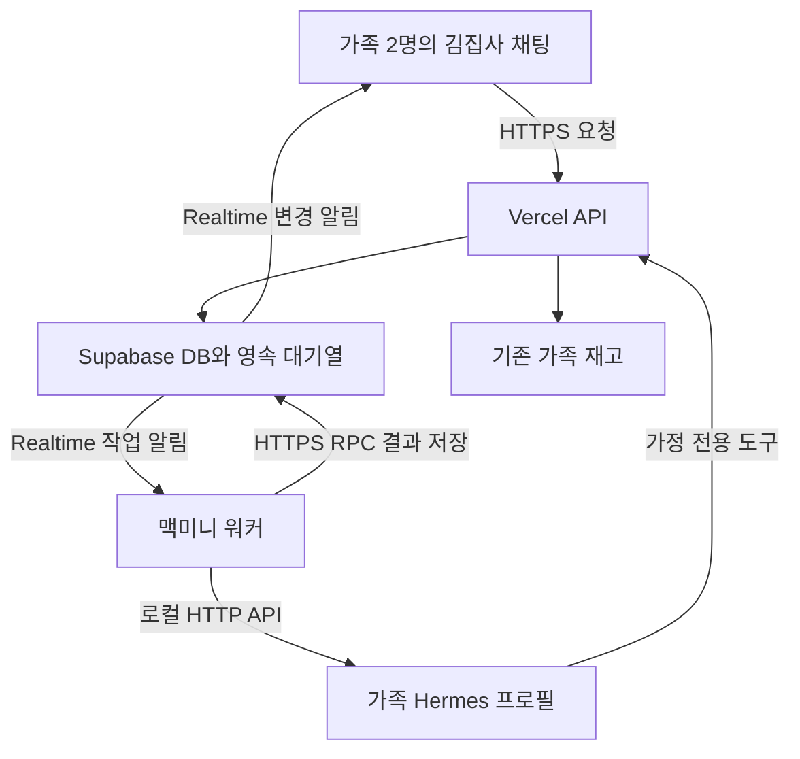

# 김집사 앱과 맥미니 공통 연동 규약

앱과 맥미니가 같은 가족·작업·메시지·영수증 초안을 처리하도록 데이터와 API, Realtime 이벤트, 복구 규칙을 맞춘다. 사용자 결정과 승인된 저장소 정책은 확정 기준으로 두며, 새 연결 규약과 운영값은 설계 제안으로 구분한다.

기준일: 2026년 11월 4일 · [전체 계획 Page](https://chatgpt.com/space/page_8dd8c181ebb48191ae73df465d86df94)

담당별 작업: [앱과 클라우드 구현 계획](./kimjipsa-app-plan.md) · [맥미니 구현 계획](./kimjipsa-mac-mini-plan.md)

## 2026-11-04 확정된 확장 규약

최신 사용자 승인과 [ADR-0017](../../02-architecture/ADR/0017-local-family-agent.md)이 아래 초기 제안보다 우선한다. 앱의 제공자·키 등록은 없으며 맥미니 Hermes 설정을 자동 사용한다.

Hermes 자체 기억·조회 스킬에 관한 최신 규약은 [ADR-0018](../../02-architecture/ADR/0018-hermes-memory-and-household-skill.md)을 따른다. 공용 프로필의 기억은 유지하고 Supabase 기억과 별도로 관리한다. `POST /api/agent/read`는 활성 워커의 가정만 읽으며 개인 내용은 제외한다.

- `/api/chat?visibility=private`: 앱 대화·첨부는 개인 전용이며 요청자만 조회·취소·확인한다. 마지막 메시지 후 1시간 만료 시 원문과 연결 작업을 삭제하고 `sessionVersion`을 올린다. 개인 대화는 가족 기억에 요약하지 않는다.
- 워커 설정의 `capabilitiesVersion=2`를 요구한다. `/api/agent/context`와 `/api/agent/complete`는 워커 Bearer·동일 Origin·jobId·leaseToken을 사용한다. `context`는 범위 내 반복 일정을 전개하고 개인 일정 내용을 공개 범위에 따라 제거한다.
- 결과 kind는 `reply`, `actions`, `action_proposal`, `receipt`, `add`, `proposal`, `summary`다. `calendar`와 `search`는 워커 내부의 추가 조회 요청이며 완료 RPC로 저장하지 않는다. 일정 추가 범위 조회는 1회·최대 366일이다.
- actions는 domain(event/inventory/cart), label, payload, expected 리비전으로 구성한다. 기존 entity 입력 검증과 SQL 쓰기 규칙을 공유한다. 리비전은 모델 값 대신 서버 조회값으로 채운다. 직접 요청은 인용문 검사 후 즉시 실행, 자체 판단은 5분간 확인 대기, 묶음 변경은 전체 성공/전체 취소다.
- 검색어는 현재 사용자 메시지의 부분 문자열로 제한한다. 검색 결과에는 URL 출처를 저장하고 화면에 링크를 표시한다. 검색 답변으로 변경 작업을 실행할 수 없다.
- 가정 Realtime payload는 `{changed:true}`다. 개인 메시지·실행 ID와 내용은 해당 사용자 권한으로 다시 조회한다.

## 초기 구현 기준

| 항목 | 기준 |
| --- | --- |
| 초기 사용자 | 한 가정의 2명. 각자 기기와 브라우저 탭 하나를 사용할 때 앱 2개와 워커 1개로 Realtime 연결 약 3개 |
| 실행 환경 | 김집사 Next.js PWA와 Vercel API, Supabase 무료 플랜, 맥미니 M4의 Hermes와 연결 워커 |
| 대화와 기억 | 가정당 공용 채팅방과 Hermes 프로필 하나. 작성자는 표시하되 개인별 대화방과 기억으로 나누지 않음 |
| 가정 간 접근 | 다른 가정의 대화·기억·사진·재고 접근 차단. 서버가 로그인 세션과 작업 권한으로 가정을 결정 |
| 전달 방식 | 앱과 맥미니 모두 비공개 Realtime 채널 구독. 실제 작업 선점·데이터 조회·파일 전송은 HTTPS와 RPC 사용 |
| 저장 원칙 | 메시지와 작업 상태는 DB에 영속 저장. Realtime 알림 자체를 메시지 원본이나 작업 대기열로 사용하지 않음 |
| AI 사용 | 가정의 Claude 또는 Gemini BYOK 유지. 영수증 분석에는 이미지 인식 가능한 모델 사용. 모델 API 사용료는 별도 |
| 변경 처리 | 명확한 직접 요청은 실행하고 결과 안내. AI의 자체 판단 변경은 확인 후 실행. 영수증은 추출 목록을 수정·확인한 뒤 반영 |

1차 범위는 가족 공용 채팅, 가족 재고 조회와 명확한 수량 등록, 영수증 품목 추출과 확인 카드, 가족 기억, 실행 복구와 사진 정리다. 일정·장바구니 전용 AI 도구는 같은 연결 구조에 후속으로 추가한다.

## 역할과 연결 구조

| 구분 | 맡을 책임 |
| --- | --- |
| 앱 화면 | 가족 공용 채팅, 사진 첨부, 처리 상태 표시, 영수증 확인 카드, 재고 목록 갱신 |
| Vercel API | 사용자와 워커 인증, 가정 권한 검사, 입력 검증, 키 암호화, 재고 변경, 사진 정리 API |
| Supabase | 메시지·작업·초안·기억 저장, RLS, 작업 대기열, 비공개 Realtime, 비공개 Storage, 예약 작업 |
| 맥미니 | Realtime 수신 워커, Hermes 프로필과 세션 운영, AI 실행, 진행 상태·결과 전달, 재시작 복구, 로컬 임시 파일 정리 |

사진은 앱에서 비공개 Storage로 올리고, 작업에는 첨부 ID와 파일 경로만 연결한다. 모델에 전달할 사진 접근 URL은 실행 직전에 짧은 유효기간으로 발급한다.

Realtime으로 작업 알림을 받은 워커가 HTTPS RPC로 대기열의 작업을 선점한다. 앱은 알림을 받은 뒤 저장된 메시지·작업·초안의 최신 상태를 조회한다. Supabase Queues는 소비자가 작업을 가져오는 구조이므로, 새 작업 등록 시 워커 알림을 발행하는 처리를 함께 구현한다. [Queues 동작](https://supabase.com/docs/guides/queues/quickstart)

## 두 쪽이 맞춰야 할 연동 규약

경로·필드·이벤트 이름은 제안이며, 앱과 워커가 개발을 나눠 시작하기 전에 함께 고정한다.

### 앱 API와 워커 RPC

| 인터페이스 제안 | 담당과 처리 |
| --- | --- |
| POST /api/chat | 앱이 사용자·가정을 확인하고 text, attachmentIds, clientRequestId, sessionVersion을 접수. 메시지와 작업 ID 반환 |
| GET /api/chat | `visibility=private`, 선택적 `before` 순서 커서. 최근 50개 또는 커서 이전 50개를 시간순으로 반환하고, `nextBefore`가 null이면 이전 대화 없음. 작업·카드·사진 정보는 해당 페이지 메시지에 연결된 것만 반환. `sessionVersion`, `expiresAt`으로 만료·페이지 초기화 판단 |
| POST /api/chat/attachments | 앱이 비공개 업로드 권한 발급. 업로드 완료 확인 후에만 작업 첨부 허용 |
| POST /api/chat/runs/:id/cancel | 앱이 가족과 실행 상태를 확인해 취소 요청. 실행 중이면 워커에 중단 전달 |
| GET /api/agent/config | 등록된 워커에 한해 연결된 가족의 실행 설정·설정 버전과 필요한 자격 공급 |
| POST /api/receipt-imports/:id/confirm | 앱이 가정·초안 버전·반영 상태를 검사하고 일괄 재고 반영 |
| POST /api/receipt-imports/:id/cancel | 앱이 미반영 초안을 취소하고 두 사용자 화면 갱신 |
| POST /api/agent/tools/:tool | 작업 권한을 검증하는 서버 도구 경로. 브라우저 쿠키를 워커에 전달하지 않음 |
| claim_agent_job | 워커가 작업을 원자적으로 선점하고 임대 토큰·기한·필요한 문맥 수신 |
| heartbeat_agent_job | 워커가 실행 임대와 진행 상태 갱신 |
| complete_agent_job 또는 fail_agent_job | 앱 측 검증 규약에 맞춰 최종 메시지·초안·오류를 저장하고 작업 종료 |

작업에는 jobId, familyId, conversationId, inputMessageId, attachmentIds, configVersion, leaseToken, leaseUntil을 연결한다. leaseToken과 키는 Realtime 이벤트나 모델 입력에 넣지 않는다.

### 이벤트와 작업 상태

| 이벤트 제안 | 전달할 내용 |
| --- | --- |
| job.ready | 작업 ID와 이벤트 ID |
| message.created | 가족 대화 ID와 메시지 ID·순서 |
| run.updated | 작업 ID·진행 상태·버전 |
| receipt.updated | 초안 ID·버전·draft 또는 applied 또는 cancelled 상태 |
| family.config.updated | 설정 버전과 기억 버전 |

agent_runs의 기본 상태는 queued, running, completed, failed, cancelled, unknown으로 둔다. 영수증 확인 대기는 receipt_imports의 draft로 표현해 가족의 다음 AI 요청을 막지 않는다.

취소나 임대 만료 뒤의 오래된 실행은 새로운 재고 변경이나 완료 결과를 저장할 수 없게 한다. unknown 작업은 도구 실행 기록을 확인하고 결과를 정리한 뒤에만 다시 실행하거나 세션을 이어간다.

알림은 중복되거나 유실될 수 있다고 가정한다. 앱은 메시지 순서와 데이터 버전으로 중복을 제거하고 DB에서 복구한다. 워커는 임대 토큰·작업 ID와 원자적 선점으로 중복 실행을 막는다. 결과 저장과 큐 확인 사이에 장애가 생겨도 이미 완료된 작업을 다시 실행하지 않는다.

## 구현 순서와 인수 조건

| 단계 | 앱과 클라우드 작업 | 맥미니 작업 | 단계 완료 조건 |
| --- | --- | --- | --- |
| 1 연동 기준 | 가족 공용 정책과 API·JSON·상태 규약 정리 | Hermes 텍스트·사진·세션 연결 확인 | 같은 작업 ID와 가족 ID로 왕복할 규약 고정 |
| 2 전달 기반 | DB·RLS·큐·비공개 채널·RPC 구현 | Realtime 수신·선점·임대·가짜 응답 처리 | AI 호출 없이 메시지와 작업 상태가 두 기기에 반영 |
| 3 공용 채팅 | 채팅 UI·키 설정·오류 안내 구현 | 가족 프로필·키 공급·텍스트 실행 연결 | 두 사람이 같은 집사와 공용 대화 |
| 4 재고 도구 | 기존 재고 규칙을 서버 도구로 연결 | 조회와 직접 요청 도구 연결 | 요청 결과가 두 기기의 기존 재고 화면에 반영 |
| 5 영수증 | 사진 업로드·초안·확인 카드·원자적 반영 | 이미지 분석·후보 연결·초안 저장 | 실제 영수증을 확인해 중복 없이 재고 등록 |
| 6 기억과 운영 | 가족 기억 관리·사진 정리·사용량 확인 | 기억 버전 반영·자동 실행·복구·로컬 정리 | 기억 변경과 재시작·사진 만료 처리 확인 |
| 7 실제 두 기기 확인 | 화면·권한·동시 확인·DB 정합 확인 | 연결 끊김·프로세스 중단·실행 불명 처리 확인 | 아래 인수 조건 충족 |

### 인수 조건

- [ ] 두 사용자 모두 같은 가족 대화·기억·영수증 카드를 보고 작성자를 구분할 수 있다.

- [ ] 다른 가정 계정은 메시지·사진·초안·기억·워커 채널에 접근할 수 없다.

- [ ] 한 영수증을 두 사람이 동시에 확인해도 재고는 한 번만 증가한다.

- [ ] 여러 품목 중 오류가 있으면 일부만 반영되지 않고 초안을 수정할 수 있다.

- [ ] 가족 밖 품목 ID, 만료된 사진, 오래된 초안 버전으로 실행할 수 없다.

- [ ] 맥미니가 꺼진 동안 접수한 작업이 보관되고, 재연결 뒤 상태와 실행 가능 여부를 확인해 복구한다.

- [ ] 재고 반영 직후 연결이 끊겨도 재연결 시 완료 결과를 확인하고 중복 반영하지 않는다.

- [ ] AI 키 누락·오류·한도 초과, 이미지 인식 실패를 구분해 해결 위치를 안내한다.

- [ ] 사진 원본이 Storage API로 삭제되고 채팅에는 만료 표시와 등록 결과가 남는다.

- [ ] 가족 기억의 수정·삭제·끄기가 다음 대화에 반영되고, 보존 정책에 따라 Hermes의 로컬 복사본도 정리된다.

검증은 기존 Vitest·Testing Library·Playwright와 폐기 가능한 DB에서 수행할 항목으로 계획한다. 실제 테스트·빌드·원격 적용의 실행은 저장소의 작업 규칙에 맞춰 진행한다.

## 무료 플랜 운영과 확정할 정책

2026년 11월 4일 기준 Supabase 무료 플랜의 주요 한도는 동시 Realtime 연결 200개, 월 메시지 200만 건, 초당 메시지 100건, DB 500MB, 파일 저장 1GB, 일반 egress 월 5GB다. 일반 egress는 Storage와 DB 등 서비스가 공유한다. 앱 2개와 워커 하나는 연결 약 3개를 사용하며, 사진 반복 다운로드와 이벤트 수는 별도로 관리한다. [요금표](https://supabase.com/pricing), [Realtime 제한](https://supabase.com/docs/guides/realtime/limits)

- 초기에는 상태 변경과 최종 답변을 중심으로 전달한다. 단순 점 애니메이션을 위해 서버 이벤트를 반복하지 않는다.

- 사진은 브라우저에서 압축하고 Supabase의 유료 이미지 변환 기능에 의존하지 않는다.

- 사진 원본과 큰 도구 결과를 메시지·대기열에 중복 저장하지 않는다.

- Supabase 대시보드에서 DB·Storage·전송량·Realtime 사용량을 확인한다. 무료 프로젝트의 비활성 일시 중지 조건도 운영에 반영한다.

- Supabase 무료 사용과 Claude·Gemini API 사용료는 별개다. 가정의 BYOK 비용을 유지한다.

| 구현 전 확정할 항목 | 현재 상태 |
| --- | --- |
| 사진 원본 보관과 정리 | 24시간 보관, 5분 주기 삭제는 제안. 사용자 확인 뒤 명세 DEC 011에 반영 |
| 가족 기억의 원본 | Supabase 원본과 Hermes 어댑터를 제안. 기존 개인별 기억 정책을 가족 공용으로 갱신 |
| 키 공급과 교체 | AES-256-GCM은 ADR 0016으로 확정. 신뢰된 맥미니에 키를 공급하는 경로와 교체 절차는 연동 설계에서 명시 |
| 가족 탈퇴와 삭제 | 공유 대화·기억·사진의 유지·삭제 범위를 가족 공용 정책에 맞춰 결정 |
| 영수증 초안 만료 | 사진 만료와 별도로 결정. 일반 AI 제안의 5분 만료를 영수증에 자동 적용하지 않음 |

앱 담당은 A1에서 A7까지와 클라우드 설정을, 맥미니 담당은 M1에서 M6까지와 로컬 운영을 맡는다. 서로의 내부 구현을 복제하지 않고, 연동 규약과 단계별 인수 조건으로 작업을 연결한다.

